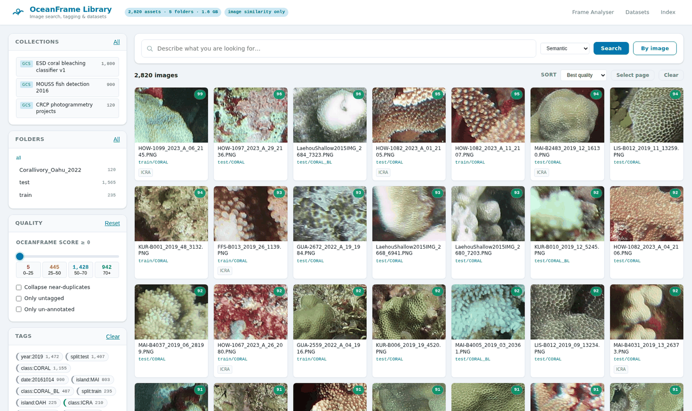
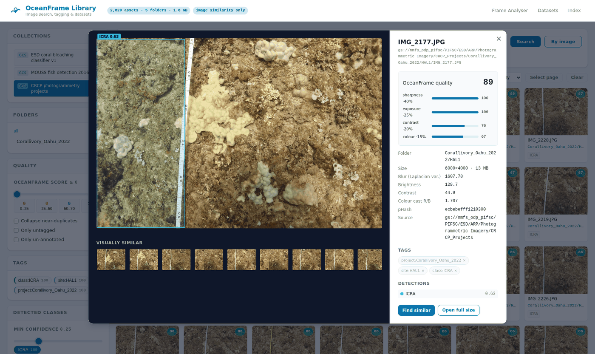

# OceanFrame

OceanFrame is a FastAPI app with two surfaces that share one deployment:

- **`/` — Frame analyser.** Upload a video or an image sequence, score every
  frame for blur, exposure and colour cast, and export the keepers as CSV or ZIP.
- **`/library` — Image library.** Index a Google Cloud Storage bucket (or a local
  tree), search it by visual similarity or text, tag it with YOLO / SAM 3, and
  build training datasets. See [docs/IMAGE_LIBRARY.md](docs/IMAGE_LIBRARY.md).
- **`/curation` — Classification curation.** An interactive confusion matrix of
  actual model results on preserved dataset splits, with version-bound evaluation,
  trusted classifier registration, and draft corrections that leave old results
  unchanged. All-project CSV suggestions remain optional. Several curators can
  work together. See [docs/CURATION.md](docs/CURATION.md).

Run on its own the app is open and single-user. Run as the **multi-user stack**
it adds sign-in, roles and an Oracle database for users and curation; on a Google
Cloud Workstation one script installs all of it — see
[Multi-user stack and Cloud Workstations](#multi-user-stack-and-cloud-workstations).

## Run locally

```bash
pip install -r requirements.txt
python launch.py
```

The app starts on `http://127.0.0.1:80` by default and opens a browser window.

## Run with Docker

```bash
make env          # writes .env: your uid/gid, plus generated ORACLE_PASSWORD and APP_SCHEMA_PASSWORD
make up-ml        # http://localhost:8081  — with CLIP, YOLO and SAM 3
```

Or without make (Windows included — there is no `make` on a stock Git Bash):

```bash
cp .env.example .env   # then set ORACLE_PASSWORD and APP_SCHEMA_PASSWORD (start with a letter)
docker compose --profile ml up -d --build app-ml
```

`make up` starts Oracle Free (the application database) and the smaller app image;
the first start takes about a minute while Oracle initialises. To use an existing
Oracle instead, set `OCEANFRAME_DB_DSN` (with `OCEANFRAME_DB_USER` and
`OCEANFRAME_DB_PASSWORD`) in `.env`. The smaller image works except for semantic text
search and model detection, because it carries no torch. **If the Models panel
says the annotators are unavailable, you are on that image** — use `up-ml`.

`make up` publishes the app on loopback (127.0.0.1) only, with sign-in off: anyone
who can reach it acts as the built-in admin on the shared database, and the app logs
a warning saying so. For a multi-user `make up` on the LAN, set
`OCEANFRAME_BIND=0.0.0.0` **together with** `OCEANFRAME_AUTH=on` and the
`OCEANFRAME_ADMIN_*` variables in `.env`. The curation, Hugging Face and evaluation
settings (`CURATION_*`) in `.env` reach the container as in the stack; validating
and evaluating models also needs the isolated evaluation worker, which runs only
in the stack.

`make up` and the stack (below) are alternatives, not companions: both run
`oceanframe-oracle` on host port 1522, so run one Oracle at a time.

The library is the landing page at **`/`**; the original frame analyser moved to
**`/frames`**, and they cross-link in the header. The container listens on 8080
as a non-root user, so no privileged port and no root-owned files. State lives
in named volumes, and `/healthz` backs a container healthcheck.

### Collections

A collection is one bucket prefix or directory with **its own path-tag rule and
its own detection model**, because a coral photogrammetry set and a fish-camera
set do not want the same one. Open **Collections** in the header to add one; the
box is pre-filled with NOAA open data, so the first one is a click away. Each
row then has a model picker and a **Scan** button that runs it over that
collection.

Models are offered from a server-side allowlist — the curated list in
`library/modelcache.py`, anything in your model directory, plus
`LIB_EXTRA_MODELS`. That is deliberate: a model reference names a pickle that
`torch.load` executes, so the browser picks from a list rather than sending a
path.

### Running SAM 3 on a selection

SAM 3 finds and segments **every instance of a concept you describe**, so it is
scoped to images you picked rather than a whole collection — it is far slower
than a detection pass, and the concepts should suit what you are looking at.

1. Search or filter down to the images you want.
2. **Select them** — tick the checkbox on a tile, shift-click tiles, or use
   **Select page**. A bar appears along the bottom.
3. In that bar choose **SAM 3 — concept segmentation**. The button changes to
   **Segment** and the concepts box turns required.
4. Type the concepts, comma separated: `bleached coral, sea urchin`.
5. Press **Segment**.

Results land as `concept:<phrase>` tags and as polygon masks drawn on the image
in the detail view, and they become facets you can filter the whole library by.
Asking for a collection-wide SAM 3 run is refused with an explanation rather
than quietly starting an hours-long job.

SAM 3's weights are access-gated: request them at
<https://huggingface.co/facebook/sam3>, download `sam3.pt`, and drop it in
`./models`. Until then it shows in the list as disabled with "weights missing".

### GPU

```bash
make up-gpu          # or: docker compose --profile gpu up -d --build app-gpu
```

Builds the same model stack against the CUDA torch wheels and reserves the GPU
for the container. It needs the NVIDIA Container Toolkit — Docker Desktop on
Windows picks this up from the WSL2 driver. Check it end to end with:

```bash
docker run --rm --gpus all oceanframe:gpu nvidia-smi
docker compose --profile gpu exec app-gpu python -c "import torch; print(torch.cuda.is_available())"
```

Measured on an RTX 4070 SUPER against 6000×4000 photogrammetry frames, SAM 3
with two concepts, model already loaded:

| | per image |
| --- | --- |
| CPU (i7-14700KF) | 5.3 s |
| GPU (RTX 4070 SUPER) | 2.0 s |

A useful speedup rather than a dramatic one, because a meaningful share of each
image is fetching 13 MB from the bucket and decoding it, not inference. The
first run of either adds ~25 s loading the 3.45 GB checkpoint.

### Profiles

Everything except the app is behind a compose profile, so a plain `up` starts
one container.

| Command | What it does |
| --- | --- |
| `make up` | The app on the core image (629 MB, no torch — no text search, no detection) |
| `make up-ml` | The app with CLIP, YOLO and SAM 3 (2.85 GB), on its own port (8081) so it can run alongside `app` |
| `make up-gpu` | The same models on an NVIDIA GPU (CUDA torch) |
| `make dev` | Live reload against your working tree |
| `make test` | The offline suite, inside the image |
| `make test-live` | The suite against `gs://nmfs_odp_pifsc` |
| `make quickstart` | Index ~2,800 real NOAA images into the app's volume |
| `make down` / `make clean` | Stop / stop and delete the catalog |

`make help` lists them all. To go from nothing to a real catalog in a browser:

```bash
make quickstart && make up
```

### Two images

`runtime` is the default and carries no model stack: indexing, quality scoring,
image similarity, dedupe, tagging and dataset export all work on the
dependency-free descriptor. `ml` adds torch, CLIP and Ultralytics for semantic
text search and model tagging, and is a separate build target so rebuilding the
app never re-resolves 3 GB of wheels.

Neither image installs any system packages: `requirements.txt` pins
`opencv-python-headless`, which drops the GUI bindings and with them the
`libGL`/`libxcb` dependency. The `ml` target swaps Ultralytics' full
`opencv-python` back out for the same reason — without it `import cv2` fails
inside the container.

### Private buckets

Public buckets need no credentials at all. For a private one, run
`gcloud auth application-default login` and add the overlay:

```bash
docker compose -f docker-compose.yml -f docker-compose.gcloud.yml up -d
```

It is a separate file because bind-mounting a possibly-missing
`~/.config/gcloud` makes Docker create it as a root-owned directory on your host.

For a VM or workstation, `restart: unless-stopped` in
[docker-compose.yml](docker-compose.yml) brings the stack back after a reboot as
long as Docker starts on boot.

## Multi-user stack and Cloud Workstations

The same app, plus sign-in and an Oracle Free database for users, sessions and
curation (the image library's catalog stays in SQLite — it is derived from the
images and can be rebuilt). The shape is CAT's, which runs this way in the field:
[docker-compose.stack.yml](docker-compose.stack.yml) for Oracle, the app and the sandboxed
evaluation worker, with [docker-compose.stack.gpu.yml](docker-compose.stack.gpu.yml) (the app) and
[docker-compose.evaluation.gpu.yml](docker-compose.evaluation.gpu.yml) (the worker) layered on for a GPU.

From zero, either way, you get three accounts (admin, `test` as a lead, `user1` as a
curator, passwords printed once and kept in `.env`), the NOAA Pacific T3 starter
projects importing in the background, and the T3 classifier validated and then scored
once on the Hugging Face project's train, val and test splits, so its confusion matrix is
ready to curate from, training patches included. Scoring all ~379k patches takes under an hour on a GPU
(most of it fetching them), several hours on CPU. An install whose baseline was scored on test and
val only is scored once more, with train, after an update.
Sign in and you land on Curation.

### Install on a Cloud Workstation (or any Debian/Ubuntu host)

```bash
git clone https://github.com/akridge/oceanframe-web-2 && cd oceanframe-web-2
bash deploy/install_oceanframe.sh          # regular: CPU, CLIP similarity search
bash deploy/install_oceanframe_gpu.sh      # GPU: CUDA torch, SAM 3 on the GPU
```

Run it as yourself (it uses `sudo` where it must). It works from a **bare base
image** — no Docker, nothing preinstalled — and copes with the way Cloud
Workstations reset everything outside `$HOME` on each stop/start:

| | where it lives | after a restart |
|---|---|---|
| the app and compose files | `~/oceanframe_deployment` | kept |
| Oracle data, catalog, models, uploads, backups | `~/oceanframe_data` | kept |
| Docker's images | `~/.oceanframe-docker` (Docker's `data-root`) | kept — no multi-GB rebuild |
| Docker itself, `/etc/docker/daemon.json`, the NVIDIA runtime | system | **reinstalled** by `~/.customize_environment.d/10-docker-root.sh` |
| the stack | containers | **started** by `~/.customize_environment.d/50-start-oceanframe.sh` |

It generates every password, writes them to `~/oceanframe_deployment/.env`
(mode 600), prints the accounts' sign-ins once, serves on port 80 (the
Workstations "open port" default) and prints the `https://80-…cloudworkstations.dev`
URL. Re-running it upgrades in place and never deletes data; to start the
database over, re-run with `OCEANFRAME_RESET_DATA=yes` (it tars a backup first).

Manage it with the scripts it leaves in `~/oceanframe_deployment`:
`oceanframe-start.sh`, `-stop`, `-restart`, `-status`, `-logs`, `-backup`, and
`oceanframe-diagnostics.sh` — containers, health, the workstation URL, Docker's
data-root and runtimes, free disk, the GPU as the app sees it, and the last boot.

Things worth knowing:

- **Machine size.** Oracle Free wants about 2 GB of RAM; pick a workstation with
  at least 8 GB for the regular stack. The first image build downloads torch
  (allow 10–20 minutes, and ~15 GB free on `$HOME`; the GPU image is bigger).
- **Alongside CAT.** Names are `oceanframe-*`, Oracle is on loopback port 1522,
  and the boot dispatcher is the same as CAT's, so the two coexist. If CAT (or
  anything else) is already running, the installer leaves Docker's `data-root`
  where it is, because moving it would take those containers down; re-run with
  `OCEANFRAME_DOCKER_ROOT=~/.oceanframe-docker` to move it anyway (both tools'
  images then survive restarts, at the cost of one rebuild).
- **Every save fails with "Cross-site request refused"?** The proxy in front
  rewrote the `Host` header. `oceanframe-diagnostics.sh` shows the refused
  requests; set `OCEANFRAME_ORIGIN_CHECK=off` in `.env` and restart.
- **SAM 3** weights are licence-gated: put `sam3.pt` in `~/oceanframe_data/models/`.

### Run the stack anywhere with Docker

Docker must already be installed (Docker Desktop is fine). One script does what the
installer does, minus the host setup: it writes `.env` with generated passwords on
the first run, builds, starts Oracle, then the app and the worker (on the GPU when
`nvidia-smi` sees one), and prints the URL and accounts.

```bash
bash deploy/stack_up.sh                    # or: make stack-up
bash deploy/stack_up.sh --fresh            # delete the stack's containers and volumes (asks first) and start over
```

By hand, with a `.env` you wrote yourself:

```bash
cp .env.example .env    # then set ORACLE_PASSWORD, APP_SCHEMA_PASSWORD, OCEANFRAME_ADMIN_*
docker compose -f docker-compose.stack.yml up -d --build
docker compose -f docker-compose.stack.yml -f docker-compose.stack.gpu.yml up -d --build   # GPU
docker compose -f docker-compose.stack.yml --profile test run --rm test-oracle            # suites on Oracle
```

Data goes in named volumes unless `.env` points `OCEANFRAME_*_DATA` at
directories. `test-oracle` brings up its own throwaway Oracle: the tests reset
the schema, so they never touch the stack's database.

### CPU Review Of The Original T3 Results

The standalone review service needs a running Oracle first, because it joins that
Oracle's network and saves reviews to its database, and it needs a sign-in. Under
`make up` it joins `oceanframe-local` (the default); under the stack, set
`OCEANFRAME_NETWORK=oceanframe-net`. It runs with `OCEANFRAME_BACKGROUND_WORKERS=off`:
one coordinator per database, and the main app is that coordinator. It reads
the original OASIS evaluation artifacts
without loading a model or requiring a GPU:

```bash
docker compose -f docker-compose.t3-review.yml up -d --build                                  # with make up
OCEANFRAME_NETWORK=oceanframe-net docker compose -f docker-compose.t3-review.yml up -d --build   # with the stack
```

Open
`http://127.0.0.1:8094/curation`. The real 56,864-image Test evaluation is
separate from the 941,550-point full unsplit annotation pool; migration does not
assign that pool to train/validation/test. Data setup and metrics are described
in [docs/CURATION.md](docs/CURATION.md#cpu-review-of-the-original-oasis-results).

### Backups

```bash
~/oceanframe_deployment/oceanframe-backup.sh -b gs://YOUR-BUCKET     # or: deploy/backup_to_gcs.sh
deploy/schedule_backup_cron.sh install -b gs://YOUR-BUCKET            # nightly at 02:00
```

A Data Pump export of the Oracle schema (consistent while running), the library
catalog via SQLite's online backup, and the config, uploaded to
`gs://BUCKET/oceanframe-backups/<timestamp>/` — with `gcloud`/`gsutil` if the host
has them, otherwise through the app container's own GCS client. `--cold` also
copies Oracle's raw datafiles with the stack stopped; `--include-env` adds `.env`
(it holds the passwords). Restoring is one `impdp` command, given at the top of
[deploy/backup_to_gcs.sh](deploy/backup_to_gcs.sh) and tested.

### Sign-in and roles

`OCEANFRAME_AUTH=on` (the stack's default) puts every page and API behind a
sign-in; off (the default for `python launch.py`) the app is open and runs as a
built-in local admin. As in CAT, people can **create their own account** from
the sign-in page and start as curators (`OCEANFRAME_SIGNUP_ROLE=viewer` to start
them read-only, `OCEANFRAME_ALLOW_SIGNUP=off` to have admins create every account
under **Users**). Only an admin can make someone a lead or an admin. Roles build
on each other:

| role | can |
|---|---|
| viewer | browse, search, export, read curation |
| curator | also tag, annotate a selection, build datasets; relabel, include/exclude and review in curation |
| lead | also add, describe and index collections; create curation projects and run imports |
| admin | also manage people |

Every curation change records who made it, and is checked against the version
the person saw — a second editor gets "Ana changed this item while you had it
open" rather than silently overwriting her.

### Moving curation work over from OASIS

```bash
python -m scripts.import_oasis_curation path/to/ai4me_jobs.db                  # report only
python -m scripts.import_oasis_curation path/to/ai4me_jobs.db --apply --user-map "Jane Doe=jdoe"
```

It reads a copy, never the original; reports orphans, over-long values and every
name in the history first; maps names to accounts (unmapped ones become
inactive placeholders); and is safe to re-run. In the stack, copy the file into
the app container and run it there:
`./oceanframe-compose.sh exec oceanframe-app python -m scripts.import_oasis_curation /tmp/ai4me_jobs.db`.

## Host bootstrap

[cloud_bootstrap.sh](cloud_bootstrap.sh) is kept for older instructions: it clones the repo
when it is not run from a checkout and hands over to `deploy/install_oceanframe.sh`
(above), so a bare Linux host ends up with the same stack, accounts and boot hooks.

```bash
curl -SL https://raw.githubusercontent.com/akridge/oceanframe-web-2/main/cloud_bootstrap.sh | sudo bash
```

`REPO_URL` and `BRANCH` choose what it clones; the installer's `OCEANFRAME_*` settings pass through.

## Image Library

Point it at a bucket and it builds a searchable catalog: thumbnails, OceanFrame
quality scores, perceptual hashes for near-duplicate collapsing, CLIP embeddings
for similarity and text search, and folder-derived tags.



*2,820 real images from `gs://nmfs_odp_pifsc`: coral bleaching classifier crops,
MOUSS fish-detection stills, and CRCP photogrammetry frames in one catalog. Tags
on the left (`island:MAI`, `class:CORAL_BL`, `split:test`) were derived from the
bucket's own folder and filename conventions.*

### Try it on real NOAA data, right now

NOAA's PIFSC open-data bucket is world-readable, so this needs no GCP project
and no `gcloud` login:

```bash
./scripts/noaa_quickstart.sh
```

That indexes ~2,800 images from three collections in
[`gs://nmfs_odp_pifsc`](https://console.cloud.google.com/storage/browser/nmfs_odp_pifsc),
gives each one a path-tag rule matching its own convention, and tags the coral
imagery with NOAA's own ESA/ICRA detector. Measured on a 16-worker crawl:

| Collection | Images | Source size | Wall clock |
| --- | --- | --- | --- |
| Coral bleaching classifier (224px PNG) | 1,800 | 132 MB | 32 s |
| MOUSS fish detection 2016 | 900 | 37 MB | 27 s |
| CRCP photogrammetry (6000×4000 JPG) | 120 | 1.5 GB | 28 s |

The resulting catalog — thumbnails, vectors, metrics and all — is 32 MB on disk.

### Use a domain model, not COCO

Running stock `yolo11n.pt` over 500 MOUSS fish frames produced 1,498
detections: `airplane` (497), `person` (477), `skateboard` (272), `bird` (211).
Confident, and entirely wrong. A COCO checkpoint has never seen a reef.

NOAA publishes a detector beside the imagery, and it is offered in the model
picker out of the box — choose it on a collection and hit **Scan**. From the
CLI, `LIB_YOLO_MODEL` accepts the same `gs://` URI and caches the weights on
first use:

```bash
export LIB_YOLO_MODEL="gs://nmfs_odp_pifsc/PIFSC/ESD/ARP/pifsc-ai-data-repository/models/yolo11-esa-icra-detector.pt"
python -m library.cli annotate --annotator yolo --query '{"quality_min": 60}'
```

That model detects `ICRA` (*Isopora crateriformis*, ESA-listed) and found it in
210 images across two collections at 0.50 mean confidence.

### Semantic search, measured

The classifier collection labels every crop `CORAL` or `CORAL_BL` (bleached),
which makes CLIP's text search checkable against ground truth it never saw:

| Query | Bleached in the top 50 |
| --- | --- |
| *(base rate across the collection)* | 27% |
| `bleached white coral` | **86%** |
| `healthy brown coral colony` | 28% |

Searching `dark deep water` likewise returns MOUSS deep-water camera frames
rather than coral crops. Text search needs the `ml` image and a re-embed
(`Rebuild all vectors`, or `python -m library.cli embed --rebuild`) — CLIP is
512-d where the fallback descriptor is 256-d, so the vectors are rebuilt rather
than mixed.



*Detail view: OceanFrame quality broken into its four components, the source
metrics, path-derived tags, and NOAA's ICRA detection drawn on the frame.*

```bash
# 1. index a source (a big first crawl belongs in a terminal, not a browser tab)
export LIB_SOURCE=gs://my-survey-bucket/2024
python -m library.cli doctor          # what is installed, what is missing
python -m library.cli index           # crawl, score, thumbnail, embed

# 2. tag with a model
python -m library.cli annotate --annotator yolo  --query '{"quality_min": 50}'
python -m library.cli annotate --annotator sam3  --prompts "fish,bleached coral"

# 3. search, then freeze the selection into a dataset and export it
python -m library.cli search "school of fish over sand" --limit 20
python -m library.cli dataset create reef-v1 --query '{"tags":["site:kaneohe"],"quality_min":55}'
python -m library.cli dataset export reef-v1 --kind yolo-detect
```

Or do all of it in the browser at `http://localhost/library`.

### What works without a GPU (or torch)

The library runs fully on its dependency-free hash descriptor: indexing, quality
scoring, image-to-image similarity, near-duplicate detection, tagging, datasets
and export. Installing `requirements-ml.txt` adds semantic **text** search
(CLIP) and model tagging (YOLO, SAM 3). Switching later needs no re-crawl —
`python -m library.cli embed --rebuild` keeps every thumbnail, score and tag.

SAM 3 weights are access-gated and are not downloaded automatically: request
them at <https://huggingface.co/facebook/sam3>, drop `sam3.pt` in `models/`, and
set `LIB_SAM3_MODEL`. Until then the SAM 3 annotator reports itself unavailable
with that message instead of failing a run.

### Deploy on a Google Cloud Workstation without Docker

For the multi-user stack, use [the installer](#install-on-a-cloud-workstation-or-any-debianubuntu-host).
For a single-user library in a venv, with no Docker or Oracle:

```bash
LIB_SOURCE=gs://my-survey-bucket WITH_ML=1 ./deploy/workstation_setup.sh
```

It creates the venv, checks the workstation service account can read the bucket,
writes `~/.oceanframe.env`, registers a `systemd --user` service so the app comes
back after a restart, and prints the tunnel command. Auth uses Application
Default Credentials, so an attached service account with
`roles/storage.objectViewer` needs no key file on disk.

### Library configuration

Every setting is a `LIB_`-prefixed environment variable; the ones worth knowing:

| Variable | Default | What it does |
| --- | --- | --- |
| `LIB_SOURCE` | *(unset)* | Bucket or directory offered by default, e.g. `gs://bucket/2024` |
| `LIB_DATA_DIR` | `./library_data` | Catalog, vectors, thumbnails, previews and exports |
| `LIB_EMBED_BACKEND` | `auto` | `clip`, `hash`, or `auto` (CLIP when importable) |
| `LIB_GCS_ANONYMOUS` | `auto` | `auto` falls back to an anonymous client, so public buckets need no credentials |
| `LIB_PATH_TAG_PATTERN` | *(unset)* | Default regex whose named groups become `key:value` tags |
| `LIB_YOLO_MODEL` | `yolo11n.pt` | Any detect/segment/classify checkpoint — a local path or a `gs://` URI |
| `LIB_SAM3_MODEL` | `sam3.pt` | Path or `gs://` URI for the SAM 3 weights |
| `LIB_MODEL_DIR` | `./models` | Where `gs://` weights are cached |
| `LIB_DUPE_DISTANCE` | `6` | pHash Hamming distance that counts as a duplicate |
| `LIB_PREVIEW_MAX_EDGE` | `1600` | Longest edge of the cached detail-view preview |
| `LIB_CRAWL_WORKERS` | `8` | Parallel fetches; the GCS connection pool is sized to match |
| `LIB_SIGNED_URLS` | `0` | Serve full-resolution images as GCS signed URLs |

Path rules are stored **per source**, because one bucket routinely holds
collections with different conventions. `--tag-pattern` on `index` sets it and
remembers it; `LIB_PATH_TAG_PATTERN` is only the fallback.

`LIB_PATH_TAG_PATTERN` is what makes folder structure searchable. With

```
LIB_PATH_TAG_PATTERN='(?P<year>\d{4})/(?P<site>[^/]+)/(?P<transect>T\d+)'
```

`2024/kaneohe/T03/img_0912.jpg` gains the tags `year:2024`, `site:kaneohe` and
`transect:T03`, which are then facets, filters and dataset selectors.

The same rule works on NOAA's real layout — this one is what the quickstart
applies to the bleaching classifier:

```
(?P<split>train|val|test)/(?P<class>[A-Z_]+)/(?P<island>[A-Z]{3})-(?P<station>[A-Z0-9]+)_(?P<year>\d{4})
```

turning `test/CORAL_BL/MAI-B2483_2019_12_16130.PNG` into `split:test`,
`class:CORAL_BL`, `island:MAI`, `station:B2483`, `year:2019`.

## Tests

```bash
pip install pytest && python -m pytest
```

The default suite is offline and needs no GPU, network or model weights.
`make test` runs it inside the container.

Two further suites cover what synthetic fixtures cannot:

```bash
# Against NOAA's public bucket: anonymous access, uppercase extensions,
# prefixes containing spaces, 13 MB frames, incremental re-crawls.
OCEANFRAME_LIVE_TESTS=1 python -m pytest tests/test_noaa_live.py -v

# Semantic ranking with real CLIP weights (downloads ~600 MB).
OCEANFRAME_CLIP_WEIGHTS=1 python -m pytest tests/test_clip_pipeline.py -v
```

The CLIP suite otherwise runs offline against a randomly-initialised model,
which exercises every line around the model — preprocessing, tokenising,
normalisation, the 512-d store, the planner's text branch — without a download.
Only the "does the ranking mean anything" test needs the weights.

## Dependency Reference

- `fastapi`: API framework for upload, analysis stream, and export routes.
- `uvicorn[standard]`: Production-capable ASGI server used to run FastAPI.
- `python-multipart`: Parses multipart form payloads for uploaded media files.
- `jinja2`: Renders HTML templates in `templates/`.
- `opencv-python`: Reads video frames and runs core frame-processing operations.
- `numpy`: Numeric primitives used in filtering and image/video calculations.
- `Pillow`: Creates and encodes thumbnails and output images.
- `piexif`: Writes EXIF metadata into JPEG exports when enabled.
- `pydantic`: Validates request bodies for the library API.
- `google-cloud-storage`: Lists and reads `gs://` objects for the library, via ADC.

Optional, in [requirements-ml.txt](requirements-ml.txt):

- `torch`, `open_clip_torch`: CLIP embeddings, which enable semantic text search.
- `ultralytics`: YOLO detection/segmentation and SAM 3 concept segmentation.

## Script Reference

- `launch.py`: Local app launcher used by `python launch.py`.
- `main.py`: FastAPI application entrypoint and router registration.
- `docker-start.sh`: Kept for older instructions; runs `deploy/stack_up.sh`.
- `Makefile`: `make help` — build, run, test and quickstart wrappers around compose.
- `docker-compose.gcloud.yml`: Overlay that mounts host ADC for private buckets.
- `cloud_bootstrap.sh`: Kept for older instructions; clones if needed and runs `deploy/install_oceanframe.sh`.
- `deploy/install_oceanframe.sh`: Cloud Workstation and Debian/Ubuntu installer for the multi-user stack.
- `deploy/stack_up.sh`: The multi-user stack on any Docker host (`--fresh` starts over).
- `deploy/workstation_setup.sh`: Google Cloud Workstation setup for the image library.
- `library/cli.py`: Batch index / embed / annotate / search / dataset commands.
- `scripts/make_demo_library.py`: Generates a synthetic survey tree to try the library on.
- `scripts/noaa_quickstart.sh`: Builds a real library from NOAA's public PIFSC bucket.

## Endpoints

- `POST /api/upload` for a single video file.
- `POST /api/upload-images` for one or more image files.
- `GET /api/stream/{session_id}` for SSE analysis updates.
- `GET /api/thumb/{session_id}/{frame_index}` for stored thumbnails.
- `GET /api/frame/{session_id}/{frame_index}` for a full-resolution frame.
- `POST /api/csv/{session_id}` for CSV export.
- `POST /api/export/{session_id}` for ZIP export.

Image library (`/api/library/…`):

- `GET  /status` for catalog stats, embedder and model availability.
- `POST /index`, `POST /embed`, `POST /annotate` to start background jobs.
- `GET  /jobs/{job_id}/stream` for SSE job progress.
- `POST /search`, `POST /facets`, `POST /folders`, `POST /duplicates` to query.
- `POST /search-by-image` for reverse image search from an upload.
- `GET  /asset/{id}`, `/thumb/{id}`, `/preview/{id}`, `/image/{id}` for one asset.
- `POST /tags`, `POST /tags/remove` to curate.
- `GET/POST /datasets`, `POST /datasets/{id}/export`, `GET /exports/{file}`.

Sign-in (`/api/auth/…`): `POST /login`, `POST /logout`, `GET /me`, `PUT /password`,
`PUT /profile`, and for admins `GET/POST /admin/users`, `PATCH /admin/users/{id}`,
`POST /admin/users/{id}/reset-password`.

Curation (`/api/curation/…`): projects, imports, items (`PATCH` and `/bulk` take
the revision the editor saw), source images, quality review, facets,
`/confusion-matrix`, `/matrix-assets`, `/status`, `/activity`, `/export` and
`/events/export` (the audit trail). See [docs/CURATION.md](docs/CURATION.md).
Model evaluation adds `/evaluation-models`, project `/evaluations`, split-scoped
matrices and immutable prediction evidence. The isolated worker is the
stack's `oceanframe-evaluation` service; setup and benchmark installation
are documented in [docs/CURATION.md](docs/CURATION.md#isolated-worker-deployment).

## Notes

- Uploaded media and generated thumbnails are stored under `uploads/` and cleaned up when sessions expire or are deleted.
- The library catalog under `library_data/` is mostly derived state — re-crawling rebuilds it, and the app never writes to the source bucket — except collection metadata typed in by hand, which is why backups include it.
- Users and curation are not derived: they live in the application database (Oracle in the stack, `library_data/app.sqlite` otherwise). Back it up.
- Sign-in is on in the stack and the installer (`OCEANFRAME_AUTH=on`); `make up` leaves it off by default, so it is for a trusted machine unless you turn it on (see Sign-in and roles).
